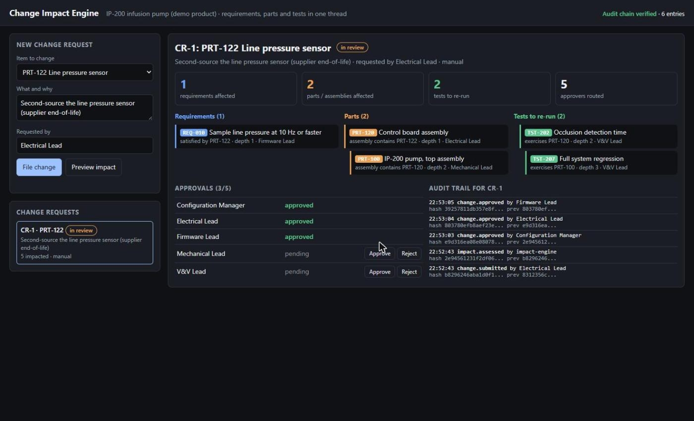

# Change Impact Engine

When an engineering change is proposed, answer in seconds: **what else does it touch, who has to approve it, and
which tests have to run again**, across three systems that normally don't talk to each other.



A personal project on engineering change management. The demo product is the **IP-200 infusion pump**, an invented
medical device; no real company or product data is used.

## The problem
At a device maker, a change (a discontinued sensor, a firmware fix, a tightened requirement) has to be reviewed for
impact before it is approved. The answer is spread across a requirements tool, the PLM / bill of materials, and test
management. Today the change board emails each area lead, merges spreadsheets and chases sign-offs; a missed link
means a test that should have been re-run wasn't. Full write-up with an illustrative cost model:
[docs/business-case.md](docs/business-case.md).

## What it does
| Step | How |
|---|---|
| Three systems of record | Mock requirements (`/alm`), parts/BOM (`/plm`) and test (`/tms`) services, each with its own tables and REST API |
| Digital thread | One `trace_link` table: `derives`, `satisfied_by`, `verified_by`, `contains`, `exercises` |
| Impact analysis | Recursive SQL walks the graph: up the BOM, out to requirements, out to tests. Each hit carries its depth and the reason |
| Event-driven | Revising an item writes an `item.changed` event to an outbox **in the same transaction**; a worker opens and assesses a change request automatically |
| Reliable processing | Idempotent consumer (a redelivered event is skipped), 3 retries, then a dead-letter queue |
| Approval routing | Approvers = the owners of every impacted item, plus Configuration Management. One rejection rejects |
| Audit trail | Append-only (DB triggers block UPDATE/DELETE) and SHA-256 hash-chained; `GET /audit/verify` detects tampering |

## Run it
```bash
pip install -r requirements-dev.txt
uvicorn cie.api:create_app --factory          # open http://127.0.0.1:8000  (API docs at /docs)
pytest                                         # 13 tests
```
Or with Docker (non-root, read-only filesystem, all capabilities dropped):
```bash
docker compose up --build                      # http://127.0.0.1:8000
```

### Try the scenario
```bash
curl localhost:8000/impact/PRT-122                                     # preview a sensor swap
curl -X POST localhost:8000/changes -H 'Content-Type: application/json' \
  -d '{"target_id":"PRT-122","description":"Second-source the pressure sensor","requested_by":"Electrical Lead"}'
curl localhost:8000/changes/1                                          # impact, approvers, re-tests
curl -X PATCH localhost:8000/plm/parts/PRT-123 -H 'Content-Type: application/json' \
  -d '{"title":"Alarm speaker, 8 ohm","summary":"Supplier end-of-life","changed_by":"Electrical Lead"}'
curl localhost:8000/changes                                            # a detected change opened by itself
curl localhost:8000/audit/verify
```

## Layout
```
cie/schema.sql   tables, trace links, outbox, append-only audit triggers
cie/impact.py    recursive impact queries
cie/events.py    outbox, idempotent worker, retries, dead letter
cie/changes.py   change requests, approval routing, decisions
cie/audit.py     hash-chained audit log and verification
cie/api.py       FastAPI app: three systems of record + engine
cie/static/      one-screen review page
tests/           impact rules, lifecycle, idempotency, dead-letter, tamper detection
docs/            spec, business case, plan
```

## Roadmap
| Next | Why |
|---|---|
| Postgres | Multi-user concurrency; recursive CTEs carry over as-is |
| AWS SQS / EventBridge for the outbox relay | Real queue between systems; consumer logic unchanged |
| Terraform deploy on AWS, GovCloud-aware (region-agnostic, FIPS endpoints) | Regulated manufacturers run there |
| OIDC sign-in, approver identity from the token | Today approver names are trusted from the request |
| CI: lint, test, image scan, SBOM, signing | Supply-chain controls |

Design choices map to public configuration-management practice (EIA-649, ISO 10007) and FDA design controls
(21 CFR 820).
